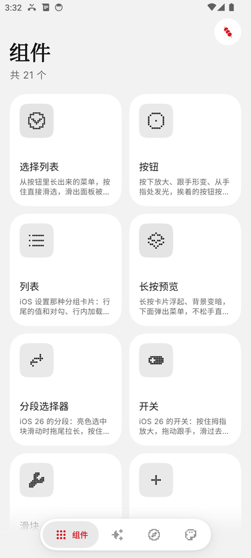
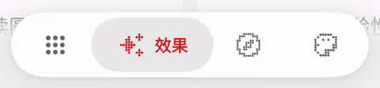
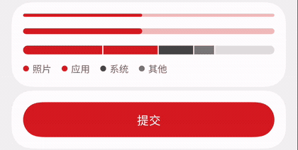
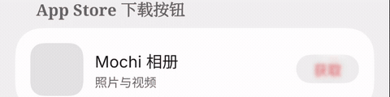
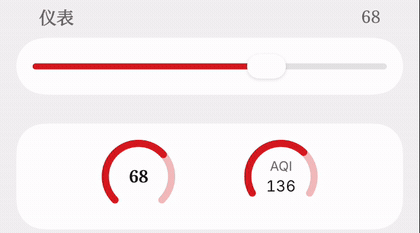
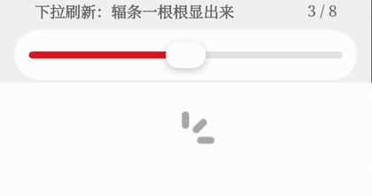
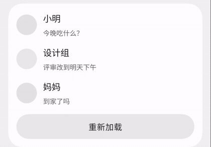

<div align="center">


# Mochi Compose

A soft, springy Jetpack Compose component library that follows your finger. Color and type come from MD3 Expressive, interaction and motion are modeled on iOS 26, and every shape uses G2 continuous corners.

[](https://jitpack.io/#feice11/mochi-compose)
[](https://github.com/feice11/mochi-compose/actions/workflows/build.yml)


[](LICENSE)

[简体中文](README.md) · English · [Download the demo APK](https://github.com/feice11/mochi-compose/releases/latest)

<a href="https://afdian.com/a/feice"></a>

</div>

## What it looks like

These are screen recordings of the demo app on an emulator. Close-ups play at half speed.

### MD3 matcha green

<table>
  <tr>
    <td align="center" width="33%"><br><sub>Card opens into a page</sub></td>
    <td align="center" width="33%"><br><sub>First-run onboarding</sub></td>
    <td align="center" width="33%"><br><sub>Light / dark switch</sub></td>
  </tr>
  <tr>
    <td align="center"><br><sub>Menu grows out of its button (0.5×)</sub></td>
    <td align="center"><br><sub>Mochi / Nothing appearances: colors blend, fonts swap through blur (0.5×)</sub></td>
    <td align="center"><br><sub>Switch thumb grows and follows a drag (0.5×)</sub></td>
  </tr>
  <tr>
    <td align="center"><br><sub>A pressed button merges with its neighbors (0.5×)</sub></td>
    <td align="center"><br><sub>Swipe actions (0.5×)</sub></td>
    <td align="center"><br><sub>Digits roll one by one (0.5×)</sub></td>
  </tr>
  <tr>
    <td align="center"><br><sub>Icons morph in place (0.5×)</sub></td>
    <td align="center"><br><sub>Icons draw on and off stroke by stroke (0.5×)</sub></td>
    <td align="center"><br><sub>Component catalog</sub></td>
  </tr>
</table>

### Nothing appearance

The Nothing appearance keeps the layout and motion but changes colors, fonts and icons: dot-matrix icons and digits, red accents and serif titles.

<table>
  <tr>
    <td align="center" width="33%"><br><sub>Catalog with dot-matrix icons</sub></td>
    <td align="center" width="33%"><br><sub>Tab bar (0.5×)</sub></td>
    <td align="center" width="33%"><br><sub>Dot-matrix digits rolling (0.5×)</sub></td>
  </tr>
  <tr>
    <td align="center"><br><sub>Progress bars and an in-button spinner (0.5×)</sub></td>
    <td align="center"><br><sub>App Store-style download button (0.5×)</sub></td>
    <td align="center"><br><sub>Gauges following a drag (0.5×)</sub></td>
  </tr>
  <tr>
    <td align="center"><br><sub>Pull-to-refresh spokes appearing one by one (0.5×)</sub></td>
    <td align="center"><br><sub>Skeleton placeholders fading into content (0.5×)</sub></td>
    <td align="center"></td>
  </tr>
</table>

There are 20-odd components:

- **Menus and overlays:** dropdown, sheet, dialog, toast, context menu, popover.
- **Controls:** button, switch, slider, stepper, segmented control, text input, wheel and date pickers, calendar, color picker.
- **Layout and navigation:** tab bar, grouped list, large title and search, sidebar, carousel, pull to refresh, badges, toolbar.

There is also page navigation (push, card expansion, shared toolbar buttons, predictive back). The press glow, rubber banding and metaball effects can be reused in your own components.

The library does not depend on material3. See [Nothing appearance](docs/guide/nothing-theme.md) for how to use that look.

## Install

Published through JitPack. Add the repository in `settings.gradle.kts`:

```kotlin
dependencyResolutionManagement {
    repositories {
        google()
        mavenCentral()
        maven("https://jitpack.io")
    }
}
```

Then the dependency (see the JitPack badge for the version):

```kotlin
implementation("com.github.feice11:mochi-compose:<version>")
```

Requires compileSdk 36+ and Kotlin 2.3+ (Capsule depends on Compose 1.10).

## Usage

```kotlin
setContent {
    MochiTheme(controller = remember { ThemeController(ColorSchemeMode.MonetSystem) }) {
        var expanded by remember { mutableStateOf(false) }
        var selected by remember { mutableIntStateOf(0) }
        val items = remember { persistentListOf(MochiItem("Recent"), MochiItem("Name"), MochiItem("Size")) }

        MochiDropdown(
            expanded = expanded,
            onExpandedChange = { expanded = it },
            items = items,
            onItemClick = { selected = it },
            selectedIndex = selected,
        ) {
            Text("Sort: ${items[selected].label}")
        }
    }
}
```

For a whole app, the quickest start is to copy [MochiAppStarter.kt](example/src/main/java/ui/feice/mochi/starter/MochiAppStarter.kt). It is a runnable three-page skeleton (home cards, list, detail) with theme, navigation and the shared toolbar already wired up. See the [integration guide](docs/guide/application-integration.md#3-copy-the-complete-starter) to register it.

Before building an app with the library (including with an AI), read the [application integration requirements](docs/guide/application-integration.md) and the [design principles](docs/guide/design-principles.md). Several effects only work when wired up as described. For example, toolbar buttons on push pages need a `navId` to be shared across the transition. AI agents can start from [llms.txt](llms.txt).

## Docs

**Components**
[Dropdown](docs/components/dropdown.md) · [Tab bar](docs/components/tabbar.md) · [Button](docs/components/button.md) · [Switch](docs/components/switch.md) · [Slider](docs/components/slider.md) · [Stepper](docs/components/stepper.md) · [List](docs/components/list.md) · [Sheet](docs/components/sheet.md) · [Segmented control](docs/components/segmented.md) · [Dialog](docs/components/dialog.md) · [Text input](docs/components/textfield.md) · [Toast](docs/components/toast.md) · [Context menu](docs/components/context-menu.md) · [Large title and search](docs/components/navbar.md) · [Sidebar](docs/components/sidebar.md) · [Wheels, time and date](docs/components/picker.md) · [Calendar](docs/components/calendar.md) · [Color picker](docs/components/color-picker.md) · [Popover and confirmation](docs/components/popover.md) · [Carousel and page control](docs/components/pager.md) · [Pull to refresh and empty state](docs/components/refresh.md) · [Badges, avatars and gauges](docs/components/badge.md) · [Toolbars and hold to confirm](docs/components/toolbar.md)

**Guides**
[App integration](docs/guide/application-integration.md) · [Theme](docs/guide/theme.md) · [Effects](docs/guide/effects.md) · [Content transitions](docs/guide/content-transitions.md) · [Navigation](docs/guide/navigation.md) · [Overscroll](docs/guide/overscroll.md) · [Haptics](docs/guide/haptics.md) · [HDR highlights (experimental)](docs/guide/hdr.md) · [Nothing appearance](docs/guide/nothing-theme.md) · [Compatibility](docs/guide/compatibility.md)

**Working on the library**
[Design philosophy](docs/guide/philosophy.md) · [Design principles](docs/guide/design-principles.md) · [Adding a component](docs/guide/adding-components.md) · [Contributing](CONTRIBUTING.md) · [Changelog](CHANGELOG.md)

## Compatibility

Android only, minSdk 23. On older versions, features degrade instead of breaking:

- **Metaball, shadows and color blending** need API 33 (`RuntimeShader`). Below that they draw as two solid rounded shapes; gestures and other animations stay the same.
- **Blur** needs Android 12. Below that you get fades and scaling only.
- **System colors** need Android 12. Older systems generate the palette from your seed color.
- **With animations turned off** in developer options, jelly, metaball and rubber-band effects turn off too.

See [Compatibility](docs/guide/compatibility.md) for details.

## Building

You need JDK 17 and Android SDK 36.

```bash
./gradlew :mochi-compose:assembleRelease
```

```bash
./gradlew :example:assembleRelease
```

Run `./gradlew spotlessApply` before committing; CI checks formatting. Without signing configured, the demo app is signed with the debug key and installs directly.

## Sponsors

Mochi is a one-person side project. If it helps you, you can support it on [afdian](https://afdian.com/a/feice); the money goes into test devices and more polish. These people have sponsored it (updated daily):

<a href="https://afdian.com/a/feice"></a>


<!-- sponsors:start -->
<table>
  <tr>
    <td align="center"><br><sub>虚言_Xenith</sub></td>
    <td align="center"><br><sub>hrsthrt74</sub></td>
    <td align="center"><br><sub>Cremy_2449</sub></td>
    <td align="center"><br><sub>爱发电用户_19bf3</sub></td>
  </tr>
</table>
<!-- sponsors:end -->

## Credits

- Shapes: [Kyant0/Capsule](https://github.com/Kyant0/Capsule)
- The counter's rolling-wheel animation: [Bear](https://github.com/mif9499)
- Engineering conventions: [miuix](https://github.com/compose-miuix-ui/miuix)
- Demo app icons: [Ionicons](https://ionic.io/ionicons)

## License

[Apache License 2.0](LICENSE). Third-party notices are in [THIRD_PARTY_NOTICES](THIRD_PARTY_NOTICES.md).
