<div align="center">

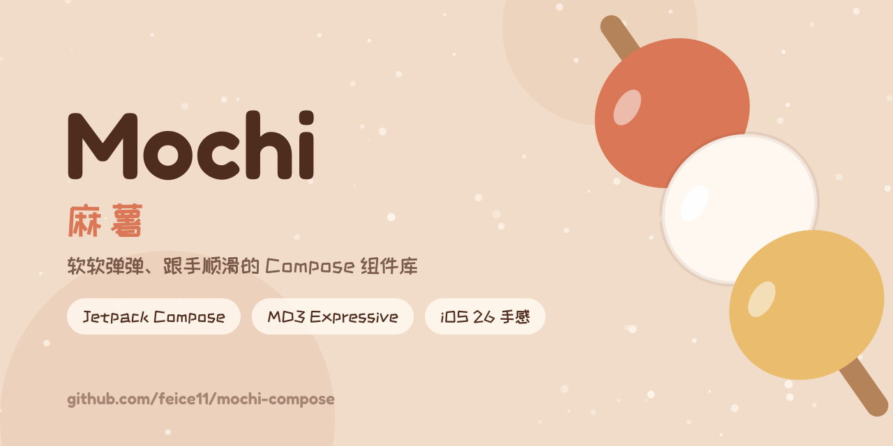

# Mochi Compose

A soft, bouncy, finger-following component library for Jetpack Compose. Colors and type come from MD3 Expressive, interaction and motion follow iOS 26, and every shape uses G2 continuous corners.

[](https://central.sonatype.com/artifact/io.github.feice11/mochi-compose)
[](https://github.com/feice11/mochi-compose/actions/workflows/build.yml)


[](LICENSE)

[简体中文](README.md) · English · [Download the demo APK](https://github.com/feice11/mochi-compose/releases/latest) · [Changelog](CHANGELOG.md)

<a href="https://afdian.com/a/feice"></a>

</div>

## What it looks like

Screen recordings of the demo app on an emulator. Close-ups play at half speed.

### MD3 matcha green

<table>
  <tr>
    <td align="center" width="33%">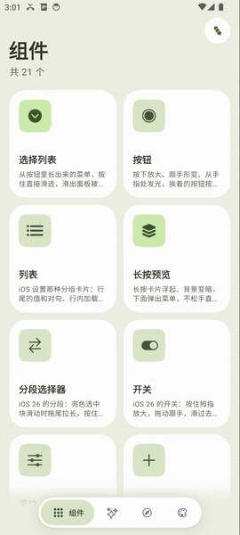<br><sub>Card opens into a page</sub></td>
    <td align="center" width="33%">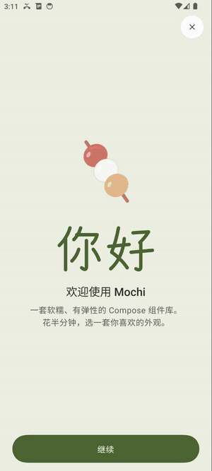<br><sub>First-run onboarding</sub></td>
    <td align="center" width="33%">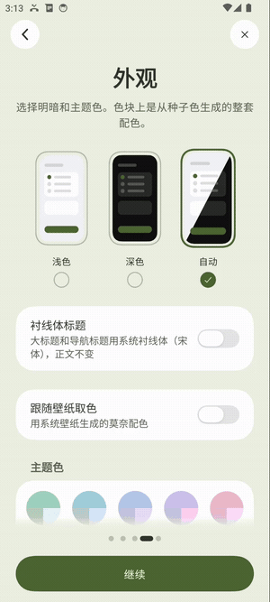<br><sub>Light / dark switch</sub></td>
  </tr>
  <tr>
    <td align="center">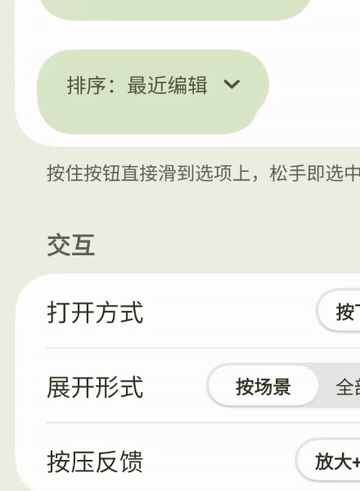<br><sub>Menu grows out of its button (0.5×)</sub></td>
    <td align="center">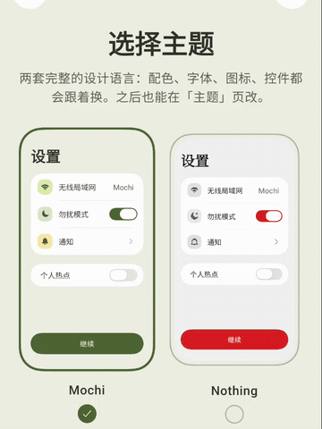<br><sub>Mochi / Nothing appearance switching (0.5×)</sub></td>
    <td align="center">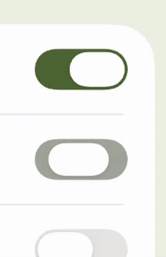<br><sub>Switch thumb grows and follows a drag (0.5×)</sub></td>
  </tr>
  <tr>
    <td align="center">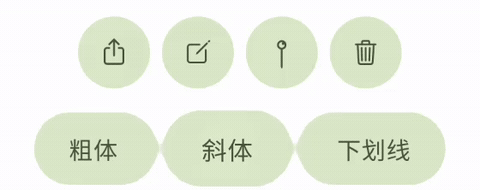<br><sub>A pressed button merges with its neighbors (0.5×)</sub></td>
    <td align="center">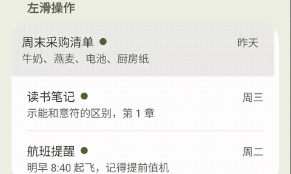<br><sub>Swipe actions (0.5×)</sub></td>
    <td align="center">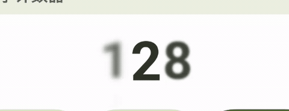<br><sub>Digits roll one by one (0.5×)</sub></td>
  </tr>
  <tr>
    <td align="center">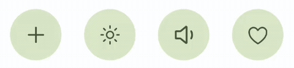<br><sub>Icons morph in place (0.5×)</sub></td>
    <td align="center">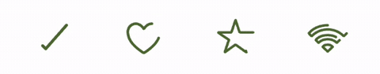<br><sub>Icons draw on and off stroke by stroke (0.5×)</sub></td>
    <td align="center">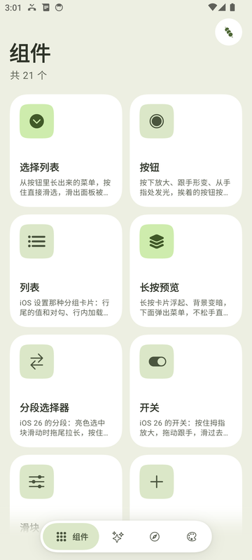<br><sub>Component catalog</sub></td>
  </tr>
</table>

### Nothing appearance

Red accents and a control palette of its own. All three appearances share the default font families and weights; liquid glass and top-bar blur can be turned on separately in any of them.

<table>
  <tr>
    <td align="center" width="33%">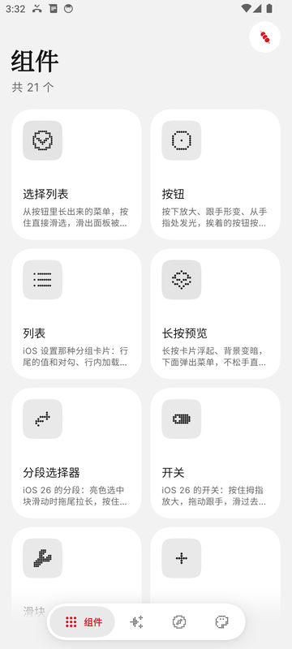<br><sub>The catalog in the Nothing appearance</sub></td>
    <td align="center" width="33%">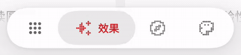<br><sub>Tab bar (0.5×)</sub></td>
    <td align="center" width="33%"><br><sub>Dot-matrix digits rolling (0.5×)</sub></td>
  </tr>
  <tr>
    <td align="center">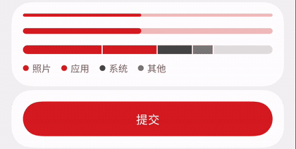<br><sub>Progress bars and an in-button spinner (0.5×)</sub></td>
    <td align="center">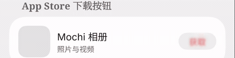<br><sub>App Store-style download button (0.5×)</sub></td>
    <td align="center">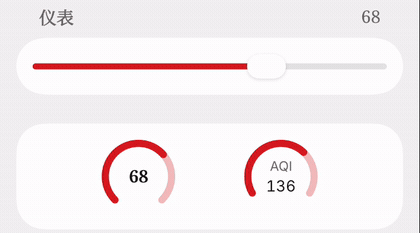<br><sub>Gauges following a drag (0.5×)</sub></td>
  </tr>
  <tr>
    <td align="center">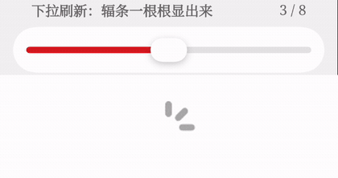<br><sub>Pull-to-refresh spokes appearing one by one (0.5×)</sub></td>
    <td align="center">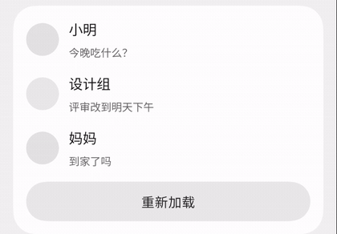<br><sub>Skeleton placeholders fading into content (0.5×)</sub></td>
    <td align="center"></td>
  </tr>
</table>

## What's inside

| Area | Contents |
|---|---|
| Controls | [Buttons and button groups](docs/components/button.md) · [Chips](docs/components/chip.md) · [Segmented control](docs/components/segmented.md) · [Switch](docs/components/switch.md) · [Slider](docs/components/slider.md) · [Intensity slider](docs/components/intensity-slider.md) · [Stepper](docs/components/stepper.md) · [Text input](docs/components/textfield.md) |
| Menus and overlays | [Dropdown](docs/components/dropdown.md) · [Context menu](docs/components/context-menu.md) · [Popover and confirmation](docs/components/popover.md) · [Dialog](docs/components/dialog.md) · [Toast](docs/components/toast.md) · [Sheet](docs/components/sheet.md) |
| Lists | [Grouped list, editing, index bar](docs/components/list.md) · [Pull to refresh and empty state](docs/components/refresh.md) · [Toolbars and hold to confirm](docs/components/toolbar.md) |
| Pickers | [Wheels, time and date](docs/components/picker.md) · [Calendar](docs/components/calendar.md) · [Color picker](docs/components/color-picker.md) · [Selection cards and miniatures](docs/components/select-frame.md) |
| Display | [Carousel and page control](docs/components/pager.md) · [Badges, avatars and gauges](docs/components/badge.md) · [Icons (all of Ionicons)](docs/components/icons.md) |
| Navigation | [Large title and search](docs/components/navbar.md) · [Tab bar](docs/components/tabbar.md) · [Sidebar](docs/components/sidebar.md) · [Navigation and page transitions](docs/guide/navigation.md) (push, one-shot transitions, shared toolbar, predictive back) |
| Effects | [Press glow, deformation, metaballs](docs/guide/effects.md) · [Content transitions and streaming text](docs/guide/content-transitions.md) · [Overscroll](docs/guide/overscroll.md) · [Haptics](docs/guide/haptics.md) · [HDR highlights (experimental)](docs/guide/hdr.md) |
| Theme and materials | [Theme, shadows, motion tiers](docs/guide/theme.md) · [Liquid glass and scroll-edge blur](docs/guide/theme.md#materials-liquid-glass-and-blur) · [iOS appearance](docs/guide/ios-theme.md) · [Nothing appearance](docs/guide/nothing-theme.md) |

No dependency on material3. All the effects can be reused in your own components.

## Installation

Published on Maven Central, so no extra repository is needed. See the badge above for the version:

```kotlin
implementation("io.github.feice11:mochi-compose:<version>")
```

Icons and appearances are separate modules; add what you need (they all depend on mochi-compose):

```kotlin
implementation("io.github.feice11:mochi-icons:<version>")   // all of Ionicons
implementation("io.github.feice11:mochi-ios:<version>")     // iOS appearance and glass materials
implementation("io.github.feice11:mochi-nothing:<version>") // Nothing appearance
```

Requires compileSdk 36+ and Kotlin 2.3+ (Capsule depends on Compose 1.10). Old 0.1.x versions remain on JitPack (`com.github.feice11:mochi-compose`, with `maven("https://jitpack.io")`).

## Usage

```kotlin
setContent {
    MochiTheme(controller = remember { ThemeController(ColorSchemeMode.MonetSystem) }) {
        var expanded by remember { mutableStateOf(false) }
        var selected by remember { mutableIntStateOf(0) }
        val items = remember { persistentListOf(MochiItem("Recent"), MochiItem("Name"), MochiItem("Size")) }

        MochiDropdown(
            expanded = expanded,
            onExpandedChange = { expanded = it },
            items = items,
            onItemClick = { selected = it },
            selectedIndex = selected,
        ) {
            Text("Sort: ${items[selected].label}")
        }
    }
}
```

Liquid glass is a material swap at the root; components read it themselves, so pages need no branches:

```kotlin
MochiTheme(colors = colors, materials = mochiGlassMaterials()) { … }
```

For a whole app, the quickest start is to copy [MochiAppStarter.kt](example/src/main/java/ui/feice/mochi/starter/MochiAppStarter.kt): a runnable three-page skeleton (home cards, list, detail) with theme, navigation and the shared toolbar already wired up. The [integration guide](docs/guide/application-integration.md#3-copy-the-complete-starter) shows how to register it.

Before building an app with the library (including with an AI), read the [application integration requirements](docs/guide/application-integration.md) and the [design principles](docs/guide/design-principles.md). Several effects only work when wired up as described; for example, toolbar buttons on push pages need a `navId` to be shared across the transition. AI agents can start from [llms.txt](llms.txt).

## Stability

- Still 0.x: minor releases may break compatibility. Every such change is marked **Breaking** in the [changelog](CHANGELOG.md) with what to change.
- Liquid glass (`MochiGlass` and the glass materials) is Beta: its look, performance and API may change in minor releases. Blur is not affected.
- The public API of each library module is recorded in `<module>/api/*.api` and checked by CI, so signature changes never ship unnoticed.

## Compatibility

Android only, minSdk 23. On older versions features degrade instead of breaking:

- **Liquid glass** needs Android 13 for the full effect. Android 12 gets the system blur with the face matrix; older versions draw a solid color.
- **Metaballs, shadows and color blending** need API 33 (`RuntimeShader`). Below that they draw as two solid rounded shapes; gestures and other animations stay the same.
- **Blur and system colors** need Android 12. Below that you get fades and scaling, and the palette is generated from your seed color.
- **With animations turned off** in developer options, jelly, metaball and rubber-band effects turn off too; apps can also turn them off with `LocalMochiReduceMotion`.

See [Compatibility](docs/guide/compatibility.md) for details.

## Building

You need JDK 17 and Android SDK 36; the screenshot tests need JDK 21 (Robolectric's SDK 35 runtime requires it).

```bash
./gradlew :mochi-compose:assembleRelease
```

```bash
./gradlew :example:assembleRelease
```

```bash
./gradlew spotlessApply apiCheck :mochi-compose:verifyRoborazziDebug
```

The last one is what to pass before committing (formatting, public API, screenshot comparison); CI runs the same checks. Without signing configured, the demo app is signed with the debug key and installs directly. Please read [Contributing](CONTRIBUTING.md) before changing the library.

## Sponsors

Mochi is a one-person side project. If it helps you, you can support it on [afdian](https://afdian.com/a/feice); the money goes into test devices and more polish. These people have sponsored it (updated daily):

<a href="https://afdian.com/a/feice"></a>

<!-- sponsors:start -->
<table>
  <tr>
    <td align="center"><br><sub>虚言_Xenith</sub></td>
    <td align="center"><br><sub>hrsthrt74</sub></td>
    <td align="center"><br><sub>Cremy_2449</sub></td>
    <td align="center"><br><sub>爱发电用户_19bf3</sub></td>
    <td align="center"><br><sub>蔡徐坤</sub></td>
    <td align="center"><br><sub>zitong</sub></td>
  </tr>
  <tr>
    <td align="center"><br><sub>小蜂-MCsmallbee</sub></td>
    <td align="center"><br><sub>洛茜不嘻嘻</sub></td>
    <td align="center"><br><sub>爱发电用户_wtBf</sub></td>
  </tr>
</table>
<!-- sponsors:end -->

## Credits

- Shapes: [Kyant0/Capsule](https://github.com/Kyant0/Capsule)
- The liquid glass render pipeline is ported from [liquid.refract.im](https://liquid.refract.im/launch/)
- The counter's rolling-wheel animation: [Bear](https://github.com/mif9499)
- Engineering conventions: [miuix](https://github.com/compose-miuix-ui/miuix)
- Icons in `mochi-icons` and the demo app: [Ionicons](https://ionic.io/ionicons) (MIT)

## License

[Apache License 2.0](LICENSE). Third-party notices are in [THIRD_PARTY_NOTICES](THIRD_PARTY_NOTICES.md).
