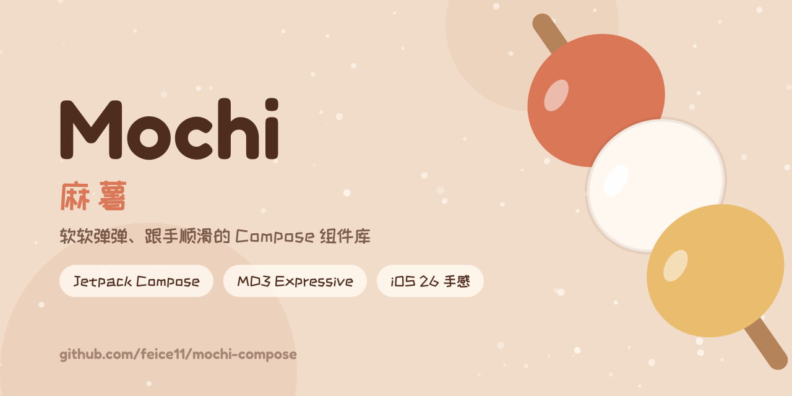
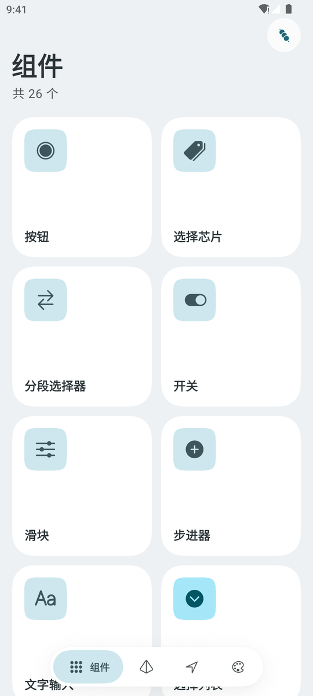
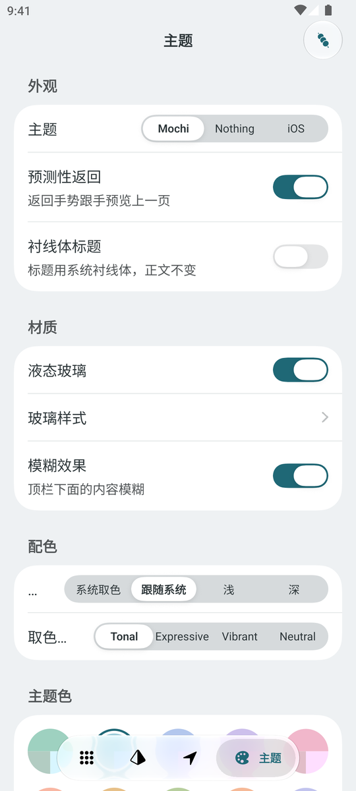
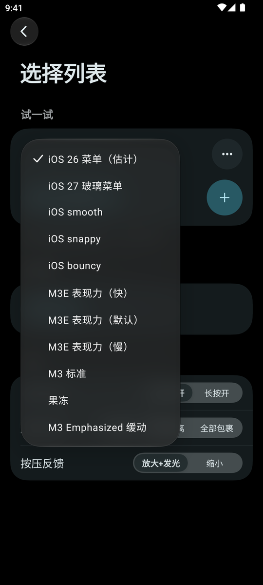
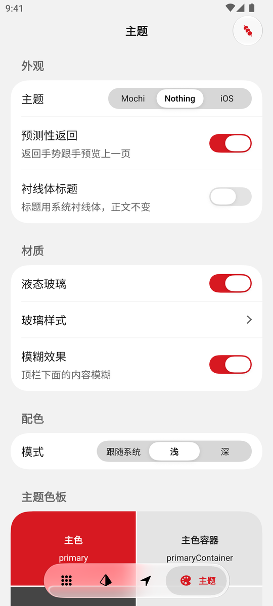

<p align="center">
  
</p>

<p align="center">Jetpack Compose UI components with iOS-style motion, G2 continuous corners, and AGSL liquid glass.</p>

<p align="center">
  <a href="https://central.sonatype.com/artifact/io.github.feice11/mochi-compose"></a>
  <a href="https://github.com/feice11/mochi-compose/actions/workflows/build.yml"></a>
  
  
  <a href="LICENSE"></a>
</p>

<p align="center">
  English · <a href="README.zh-CN.md">简体中文</a> · <a href="https://github.com/feice11/mochi-compose/releases/latest">Demo APK</a> · <a href="CHANGELOG.md">Changelog</a>
</p>

<p align="center">
  <a href="https://afdian.com/a/feice"></a>
</p>

Mochi is a Jetpack Compose UI library for Android. Color and typography follow Material 3 Expressive; interaction and motion follow iOS 26. Controls stretch toward the touch point, menus expand from their trigger buttons, and page transitions use interruptible springs with predictive back. Mochi has no dependency on `material3`.

<table>
  <tr>
    <td align="center" width="25%"><br><sub>Component catalog</sub></td>
    <td align="center" width="25%"><br><sub>Liquid glass tab bar</sub></td>
    <td align="center" width="25%"><br><sub>Glass menu, dark mode</sub></td>
    <td align="center" width="25%"><br><sub>Nothing appearance</sub></td>
  </tr>
</table>

## Installation

```kotlin
dependencies {
    implementation("io.github.feice11:mochi-compose:0.3.0")

    // Optional modules
    implementation("io.github.feice11:mochi-icons:0.3.0")   // Ionicons vector set
    implementation("io.github.feice11:mochi-ios:0.3.0")     // iOS appearance
    implementation("io.github.feice11:mochi-nothing:0.3.0") // Nothing appearance
}
```

Requires `compileSdk` 36, `minSdk` 23, and Kotlin 2.3. Artifacts are published to Maven Central under `io.github.feice11` (`0.1.x` artifacts remain on JitPack as `com.github.feice11:mochi-compose`).

## Usage

```kotlin
setContent {
    MochiTheme(controller = remember { ThemeController(ColorSchemeMode.MonetSystem) }) {
        var expanded by remember { mutableStateOf(false) }
        var selected by remember { mutableIntStateOf(0) }
        val items = remember { persistentListOf(MochiItem("Recent"), MochiItem("Name"), MochiItem("Size")) }

        MochiDropdown(
            expanded = expanded,
            onExpandedChange = { expanded = it },
            items = items,
            onItemClick = { selected = it },
            selectedIndex = selected,
        ) {
            Text("Sort by ${items[selected].label}")
        }
    }
}
```

Liquid glass is configured once at the theme root. Components read `MochiTheme.materials` directly, so screens require no material branches:

```kotlin
MochiTheme(colors = colors, materials = mochiGlassMaterials()) { /* ... */ }
```

To bootstrap a new app, copy [MochiAppStarter.kt](example/src/main/java/ui/feice/mochi/starter/MochiAppStarter.kt), a runnable three-screen starter with theme, navigation, source-card transitions, and shared toolbars wired up. Read the [application integration guide](docs/guide/application-integration.md) for architecture and component rules, or pass [llms.txt](llms.txt) to coding assistants.

## Components

- Controls: [buttons, button groups and download button](docs/components/button.md), [chips](docs/components/chip.md), [segmented control](docs/components/segmented.md), [switch](docs/components/switch.md), [slider](docs/components/slider.md), [intensity slider](docs/components/intensity-slider.md), [stepper](docs/components/stepper.md), [text field](docs/components/textfield.md)
- Menus and overlays: [dropdown](docs/components/dropdown.md), [context menu](docs/components/context-menu.md), [popover, confirmations and radial menu](docs/components/popover.md), [dialog](docs/components/dialog.md), [toast](docs/components/toast.md), [sheet](docs/components/sheet.md)
- Lists and toolbars: [grouped list, editing and index bar](docs/components/list.md), [pull to refresh, empty state and loading](docs/components/refresh.md), [bottom, floating and keyboard toolbars](docs/components/toolbar.md)
- Pickers: [wheel, date and time](docs/components/picker.md), [calendar](docs/components/calendar.md), [color picker](docs/components/color-picker.md), [selection cards](docs/components/select-frame.md)
- Display: [carousel and page control](docs/components/pager.md), [badges, avatars and gauges](docs/components/badge.md), [icons](docs/components/icons.md), [expressive shapes and morphing](docs/components/shapes.md)
- Navigation: [large title and search](docs/components/navbar.md), [tab bar](docs/components/tabbar.md), [sidebar](docs/components/sidebar.md), [page transitions and predictive back](docs/guide/navigation.md)

Guides: [design philosophy](docs/guide/philosophy.md), [design principles](docs/guide/design-principles.md), [theme and materials](docs/guide/theme.md), [effects](docs/guide/effects.md), [content transitions](docs/guide/content-transitions.md), [overscroll](docs/guide/overscroll.md), [haptics](docs/guide/haptics.md), [iOS appearance](docs/guide/ios-theme.md), [Nothing appearance](docs/guide/nothing-theme.md), [HDR highlights](docs/guide/hdr.md), [compatibility](docs/guide/compatibility.md).

## Compatibility

Android only, `minSdk` 23. Visual effects degrade cleanly on earlier Android versions without runtime errors:

| Feature | Full support | Fallback |
|---|---|---|
| Liquid glass | Android 13 (API 33, AGSL) | Android 12: system blur with face color matrix. Android 11 and lower: solid color |
| Metaballs, procedural shadows, color blending | Android 13 (`RuntimeShader`) | Separate continuous-corner shapes |
| Content blur, progressive blur, dynamic color | Android 12 (`RenderEffect` / Monet) | Alpha and scale transitions; palette generated from seed color |

Disabling animations in system Developer Options turns off spring overshoot and elastic stretch effects automatically. Apps can also override `LocalMochiReduceMotion`.

## Stability

Mochi is pre-1.0. Minor releases may introduce source-incompatible changes, documented under **Breaking** in the [changelog](CHANGELOG.md) with migration instructions. Liquid glass is in Beta and its visuals and API may evolve across minor releases. Public API signatures are recorded in `<module>/api/*.api` and verified in CI.

## Building

Compiling the library and demo app requires JDK 17+ and Android SDK 36. Running JVM screenshot tests requires JDK 21.

```bash
./gradlew :example:assembleRelease
./gradlew spotlessApply apiCheck :mochi-compose:verifyRoborazziDebug
```

Read [CONTRIBUTING.md](CONTRIBUTING.md) before submitting pull requests.

## Star history

<a href="https://star-history.com/#feice11/mochi-compose&Date">
  <picture>
    <source media="(prefers-color-scheme: dark)" srcset="https://api.star-history.com/svg?repos=feice11/mochi-compose&type=Date&theme=dark">
    
  </picture>
</a>

## Sponsors

Mochi is maintained independently in spare time. If it saves you engineering effort, consider supporting development on [afdian](https://afdian.com/a/feice). The sponsor roster below updates daily.

<a href="https://afdian.com/a/feice"></a>

<!-- sponsors:start -->
<table>
  <tr>
    <td align="center"><br><sub>虚言_Xenith</sub></td>
    <td align="center"><br><sub>hrsthrt74</sub></td>
    <td align="center"><br><sub>Cremy_2449</sub></td>
    <td align="center"><br><sub>爱发电用户_19bf3</sub></td>
    <td align="center"><br><sub>蔡徐坤</sub></td>
    <td align="center"><br><sub>zitong</sub></td>
  </tr>
  <tr>
    <td align="center"><br><sub>小蜂-MCsmallbee</sub></td>
    <td align="center"><br><sub>洛茜不嘻嘻</sub></td>
    <td align="center"><br><sub>爱发电用户_wtBf</sub></td>
  </tr>
</table>
<!-- sponsors:end -->

## Credits

- [Kyant0/Capsule](https://github.com/Kyant0/Capsule): G2 continuous-corner shapes
- [Kyant0/AndroidLiquidGlass](https://github.com/Kyant0/AndroidLiquidGlass): backdrop layer capture (`io.github.kyant0:backdrop`)
- [Nevodev/Cresto](https://github.com/Nevodev/Cresto): overscroll spring and curve adaptation
- [liquid.refract.im](https://liquid.refract.im/launch/): WebGL liquid glass shader and recipe source (ported with permission)
- [Bear](https://github.com/mif9499): rolling counter digit transitions
- [miuix](https://github.com/compose-miuix-ui/miuix): project and API conventions
- [Ionicons](https://ionic.io/ionicons) (MIT): icon artwork for `mochi-icons`

## License

Licensed under the [Apache License 2.0](LICENSE). Third-party notices and attributions are listed in [THIRD_PARTY_NOTICES.md](THIRD_PARTY_NOTICES.md).
