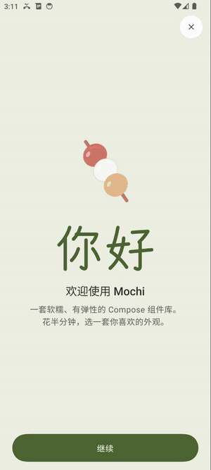
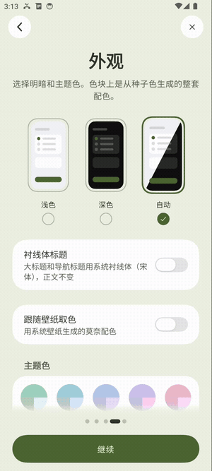
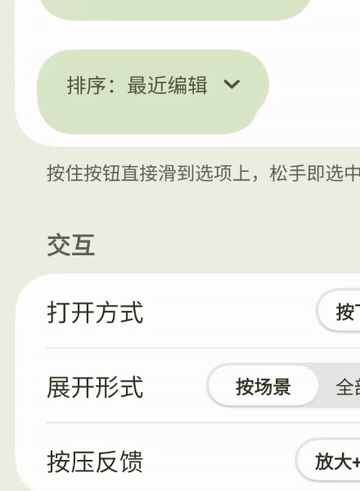
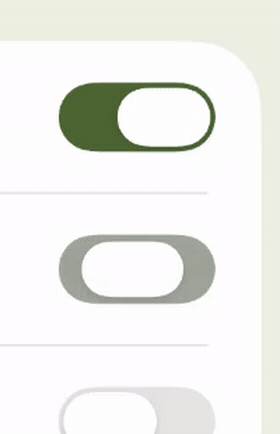
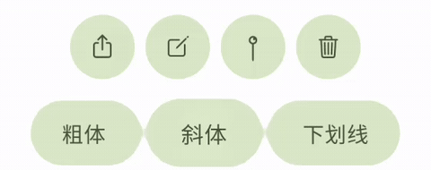
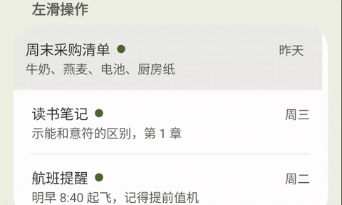
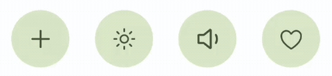
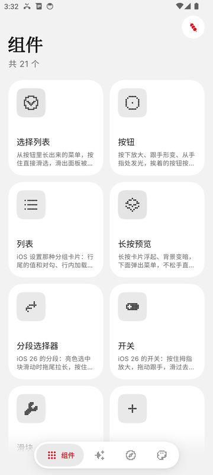
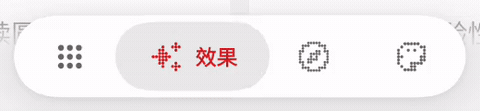
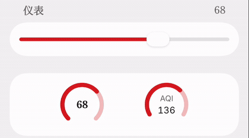

<div align="center">


# Mochi Compose

软、弹、跟手的 Jetpack Compose 组件库。配色和字阶来自 MD3 Expressive，交互和动效照着 iOS 26 做，形状统一用 G2 连续圆角。

[](https://central.sonatype.com/artifact/io.github.feice11/mochi-compose)
[](https://github.com/feice11/mochi-compose/actions/workflows/build.yml)


[](LICENSE)

简体中文 · [English](README.en.md) · [下载示例 APK](https://github.com/feice11/mochi-compose/releases/latest) · [更新日志](CHANGELOG.md)

<a href="https://afdian.com/a/feice"></a>

</div>

## 效果

下面是示例 app 在模拟器上的录屏，特写是 0.5 倍速。

### MD3 抹茶绿

<table>
  <tr>
    <td align="center" width="33%"><br><sub>卡片展开成页面</sub></td>
    <td align="center" width="33%"><br><sub>首次启动的引导</sub></td>
    <td align="center" width="33%"><br><sub>切换深浅色</sub></td>
  </tr>
  <tr>
    <td align="center"><br><sub>菜单从按钮里长出来（0.5×）</sub></td>
    <td align="center"><br><sub>Mochi / Nothing 外观切换（0.5×）</sub></td>
    <td align="center"><br><sub>开关按住放大、拖动跟手（0.5×）</sub></td>
  </tr>
  <tr>
    <td align="center"><br><sub>按住按钮，和旁边的融在一起（0.5×）</sub></td>
    <td align="center"><br><sub>左右滑出操作（0.5×）</sub></td>
    <td align="center"><br><sub>数字逐位滚动（0.5×）</sub></td>
  </tr>
  <tr>
    <td align="center"><br><sub>图标原位变形（0.5×）</sub></td>
    <td align="center"><br><sub>图标一笔笔画出、擦掉（0.5×）</sub></td>
    <td align="center"><br><sub>组件目录</sub></td>
  </tr>
</table>

### Nothing 外观

红色强调和一套专用的控件配色。三套外观共用默认字体与字重，液态玻璃和顶栏模糊在任何外观下都能单独打开。

<table>
  <tr>
    <td align="center" width="33%"><br><sub>Nothing 外观的组件目录</sub></td>
    <td align="center" width="33%"><br><sub>标签栏（0.5×）</sub></td>
    <td align="center" width="33%"><br><sub>点阵数字逐位滚动（0.5×）</sub></td>
  </tr>
  <tr>
    <td align="center"><br><sub>进度条和按钮里的加载（0.5×）</sub></td>
    <td align="center"><br><sub>App Store 式下载按钮（0.5×）</sub></td>
    <td align="center"><br><sub>仪表跟着拖动（0.5×）</sub></td>
  </tr>
  <tr>
    <td align="center"><br><sub>下拉刷新的辐条一根根出现（0.5×）</sub></td>
    <td align="center"><br><sub>骨架占位，加载完原地淡入（0.5×）</sub></td>
    <td align="center"></td>
  </tr>
</table>

## 有什么

| 分类 | 内容 |
|---|---|
| 控件 | [按钮与按钮组](docs/zh_CN/components/button.md) · [选择芯片](docs/zh_CN/components/chip.md) · [分段选择器](docs/zh_CN/components/segmented.md) · [开关](docs/zh_CN/components/switch.md) · [滑块](docs/zh_CN/components/slider.md) · [强度调整条](docs/zh_CN/components/intensity-slider.md) · [步进器](docs/zh_CN/components/stepper.md) · [文字输入](docs/zh_CN/components/textfield.md) |
| 菜单与浮层 | [选择列表（下拉菜单）](docs/zh_CN/components/dropdown.md) · [长按预览](docs/zh_CN/components/context-menu.md) · [弹出层与确认](docs/zh_CN/components/popover.md) · [对话框](docs/zh_CN/components/dialog.md) · [提示](docs/zh_CN/components/toast.md) · [底部面板](docs/zh_CN/components/sheet.md) |
| 列表 | [分组列表、列表编辑、字母索引](docs/zh_CN/components/list.md) · [下拉刷新与空状态](docs/zh_CN/components/refresh.md) · [工具栏与长按确认](docs/zh_CN/components/toolbar.md) |
| 选择器 | [滚筒与时间日期](docs/zh_CN/components/picker.md) · [日历](docs/zh_CN/components/calendar.md) · [颜色选择](docs/zh_CN/components/color-picker.md) · [选择卡片与缩小预览](docs/zh_CN/components/select-frame.md) |
| 展示 | [轮播与页面指示器](docs/zh_CN/components/pager.md) · [徽标、头像与仪表](docs/zh_CN/components/badge.md) · [图标（全套 Ionicons）](docs/zh_CN/components/icons.md) |
| 导航 | [大标题与搜索栏](docs/zh_CN/components/navbar.md) · [标签栏](docs/zh_CN/components/tabbar.md) · [侧边栏](docs/zh_CN/components/sidebar.md) · [页面导航与转场](docs/zh_CN/guide/navigation.md)（侧推、一镜到底、共享顶栏、预测性返回） |
| 效果 | [按压高光、形变、融球](docs/zh_CN/guide/effects.md) · [内容变换与流式文字](docs/zh_CN/guide/content-transitions.md) · [越界回弹](docs/zh_CN/guide/overscroll.md) · [触感](docs/zh_CN/guide/haptics.md) · [HDR 高光（实验性）](docs/zh_CN/guide/hdr.md) |
| 主题与材质 | [主题、阴影、动效档位](docs/zh_CN/guide/theme.md) · [液态玻璃与滚动边缘模糊](docs/zh_CN/guide/theme.md#材质液态玻璃与模糊) · [iOS 外观](docs/zh_CN/guide/ios-theme.md) · [Nothing 外观](docs/zh_CN/guide/nothing-theme.md) |

不依赖 material3。效果都能拿去给自己的组件用。

## 安装

发布在 Maven Central，不用额外加仓库，版本号见上面的徽章：

```kotlin
implementation("io.github.feice11:mochi-compose:<版本>")
```

图标和外观各是一个模块，按需添加（都依赖 mochi-compose）：

```kotlin
implementation("io.github.feice11:mochi-icons:<版本>")   // 全套 Ionicons
implementation("io.github.feice11:mochi-ios:<版本>")     // iOS 外观与玻璃材质
implementation("io.github.feice11:mochi-nothing:<版本>") // Nothing 外观
```

要求 compileSdk 36 以上、Kotlin 2.3 以上（Capsule 依赖 Compose 1.10）。0.1.x 的旧版本还在 JitPack（`com.github.feice11:mochi-compose`，要加 `maven("https://jitpack.io")`）。

## 用起来

```kotlin
setContent {
    MochiTheme(controller = remember { ThemeController(ColorSchemeMode.MonetSystem) }) {
        var expanded by remember { mutableStateOf(false) }
        var selected by remember { mutableIntStateOf(0) }
        val items = remember { persistentListOf(MochiItem("最近"), MochiItem("名称"), MochiItem("大小")) }

        MochiDropdown(
            expanded = expanded,
            onExpandedChange = { expanded = it },
            items = items,
            onItemClick = { selected = it },
            selectedIndex = selected,
        ) {
            Text("排序：${items[selected].label}")
        }
    }
}
```

打开液态玻璃只需要在根部换一下材质，组件自己读，页面里不用判断：

```kotlin
MochiTheme(colors = colors, materials = mochiGlassMaterials()) { … }
```

要做一整个应用，最快的办法是把 [MochiAppStarter.kt](example/src/main/java/ui/feice/mochi/starter/MochiAppStarter.kt) 复制过去改。它是一个能直接运行的三页骨架（首页卡片、列表、详情），主题、导航、共享顶栏都接好了，注册方法见 [接入指南](docs/zh_CN/guide/application-integration.md#3-复制完整应用骨架)。

用这个库写应用（包括让 AI 写）之前，先看 [应用接入规范](docs/zh_CN/guide/application-integration.md) 和 [设计规范](docs/zh_CN/guide/design-principles.md)。不少效果要按规范接才会生效，比如侧推页的顶栏按钮要登记 `navId` 才会在转场里共享。给 AI 的入口是 [llms.txt](llms.txt)。

## 稳定性

- 还在 0.x：小版本之间可能有不兼容的改动，每一处都在 [更新日志](CHANGELOG.md) 里标成 **不兼容**，并写了怎么改。
- 液态玻璃（`MochiGlass` 和各处的玻璃材质）是 Beta：外观、性能和 API 可能在小版本里调整。模糊不受影响。
- 每个库模块的公开 API 记在 `<模块>/api/*.api`，CI 会比对，签名变化不会悄悄发出去。

## 兼容性

只支持 Android，minSdk 23。低版本会降级，但不会坏：

- 液态玻璃的完整效果要 Android 13。Android 12 只有系统模糊加面色矩阵，更低的版本画纯色。
- 融球、阴影、融色要 API 33（`RuntimeShader`）。更低的版本画成两块纯色的圆角形状，手势和其他动画照常。
- 模糊和系统取色要 Android 12。更低的版本只有淡入淡出和缩放，配色用你给的种子色生成。
- 开发者选项里关掉动画时，果冻、融球、橡皮筋这些弹性效果也跟着关掉；应用也可以用 `LocalMochiReduceMotion` 自己关。

各版本的具体差异见 [兼容性](docs/zh_CN/guide/compatibility.md)。

## 自己构建

需要 JDK 17 和 Android SDK 36；跑截图测试要 JDK 21（Robolectric 的 SDK 35 运行库需要）。

```bash
./gradlew :mochi-compose:assembleRelease
```

```bash
./gradlew :example:assembleRelease
```

```bash
./gradlew spotlessApply apiCheck :mochi-compose:verifyRoborazziDebug
```

最后一条是提交前要过的检查：格式、公开 API、截图对比，CI 跑的也是这些。示例 app 没配签名时用 debug key 签名，可以直接安装。改库之前请先看 [贡献指南](CONTRIBUTING.md)。

## 赞助

Mochi 是我一个人业余时间在做的。如果它帮到了你，可以在 [爱发电](https://afdian.com/a/feice) 请我喝杯奶茶，钱会花在测试机和继续打磨上。下面这些人赞助过，名单每天自动更新：

<a href="https://afdian.com/a/feice"></a>

<!-- sponsors:start -->
<table>
  <tr>
    <td align="center"><br><sub>虚言_Xenith</sub></td>
    <td align="center"><br><sub>hrsthrt74</sub></td>
    <td align="center"><br><sub>Cremy_2449</sub></td>
    <td align="center"><br><sub>爱发电用户_19bf3</sub></td>
    <td align="center"><br><sub>蔡徐坤</sub></td>
    <td align="center"><br><sub>zitong</sub></td>
  </tr>
  <tr>
    <td align="center"><br><sub>小蜂-MCsmallbee</sub></td>
    <td align="center"><br><sub>洛茜不嘻嘻</sub></td>
    <td align="center"><br><sub>爱发电用户_wtBf</sub></td>
  </tr>
</table>
<!-- sponsors:end -->

## 致谢

- 形状用的是 [Kyant0/Capsule](https://github.com/Kyant0/Capsule)。
- 液态玻璃的渲染管线移植自 [liquid.refract.im](https://liquid.refract.im/launch/)。
- 计数器的滚轮动画来自 [Bear](https://github.com/mif9499)。
- 工程规范参考了 [miuix](https://github.com/compose-miuix-ui/miuix)。
- `mochi-icons` 和示例 app 的图标来自 [Ionicons](https://ionic.io/ionicons)（MIT）。

## 许可

[Apache License 2.0](LICENSE)。第三方代码和资源的声明见 [THIRD_PARTY_NOTICES](THIRD_PARTY_NOTICES.md)。
