<div align="center">

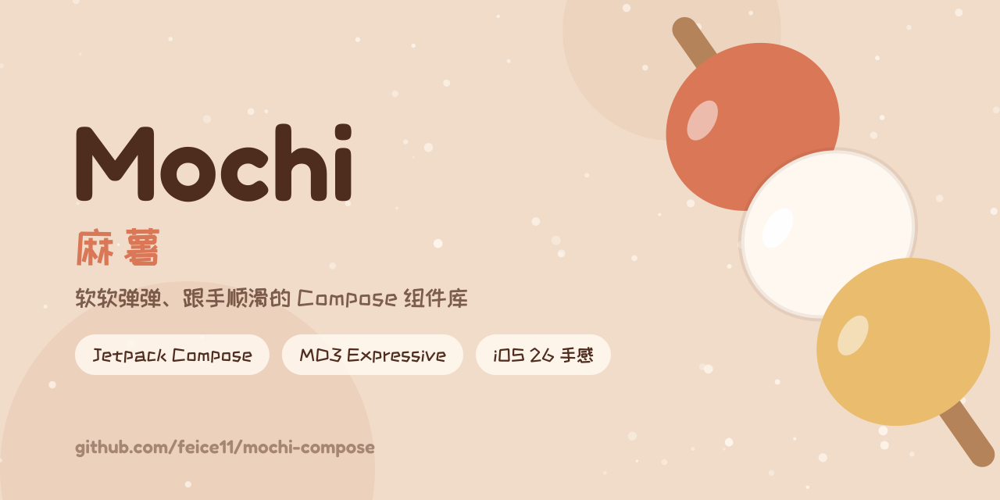

# Mochi Compose

软、弹、跟手的 Jetpack Compose 组件库。配色和字阶来自 MD3 Expressive，交互和动效照着 iOS 26 做，形状统一用 G2 连续圆角。

[](https://jitpack.io/#feice11/mochi-compose)
[](https://github.com/feice11/mochi-compose/actions/workflows/build.yml)


[](LICENSE)
[](https://afdian.com/a/feice)

简体中文 · [English](README.en.md) · [下载示例 APK](https://github.com/feice11/mochi-compose/releases/latest)

</div>

## 效果

下面都是示例 app 在模拟器上的录屏，配色是 MD3 抹茶绿。特写用的是 0.5 倍速。

<table>
  <tr>
    <td align="center" width="33%">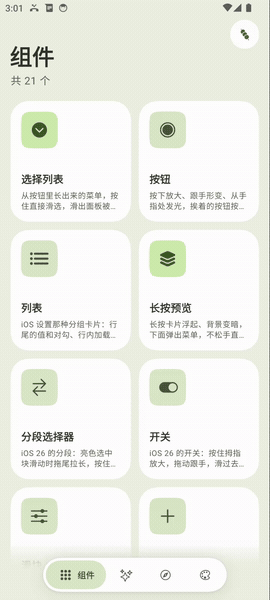<br><sub>卡片展开成页面</sub></td>
    <td align="center" width="33%">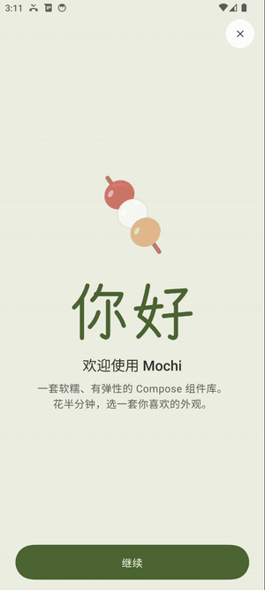<br><sub>首次启动的引导</sub></td>
    <td align="center" width="33%">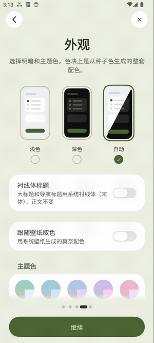<br><sub>切换深浅色</sub></td>
  </tr>
  <tr>
    <td align="center">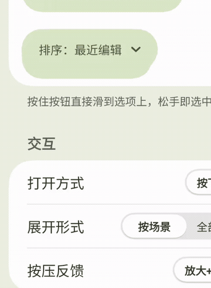<br><sub>菜单从按钮里长出来（0.5×）</sub></td>
    <td align="center">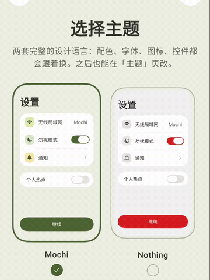<br><sub>Mochi / Nothing 两套外观，颜色过渡、字体模糊替换（0.5×）</sub></td>
    <td align="center">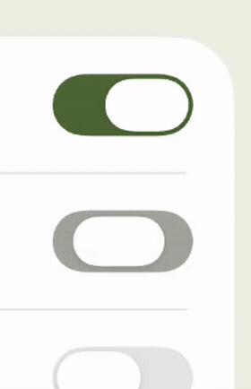<br><sub>开关按住放大、拖动跟手（0.5×）</sub></td>
  </tr>
  <tr>
    <td align="center">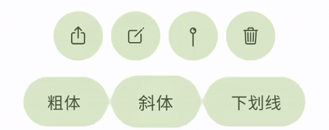<br><sub>按住按钮，和旁边的融在一起（0.5×）</sub></td>
    <td align="center">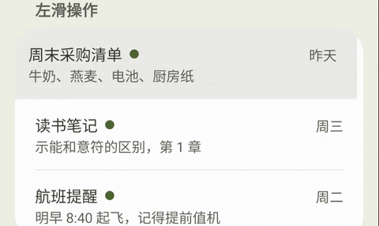<br><sub>左右滑出操作（0.5×）</sub></td>
    <td align="center">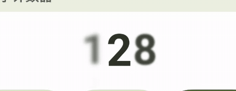<br><sub>数字逐位滚动（0.5×）</sub></td>
  </tr>
  <tr>
    <td align="center">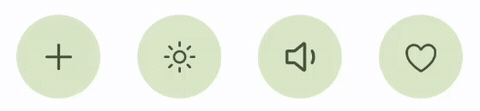<br><sub>图标原位变形（0.5×）</sub></td>
    <td align="center"><br><sub>图标一笔笔画出、擦掉（0.5×）</sub></td>
    <td align="center">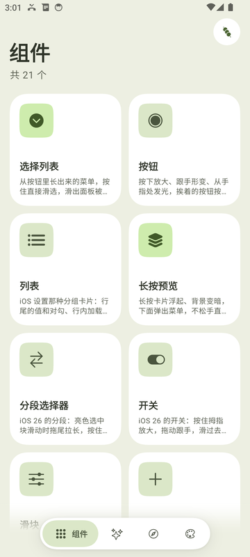<br><sub>组件目录</sub></td>
  </tr>
</table>

目前有 20 多个组件：下拉菜单、标签栏、按钮、开关、滑块、步进器、分组列表、底部面板、分段选择器、对话框、输入框、提示、长按预览、大标题和搜索栏、侧边栏、滚筒和日期选择、日历、取色器、弹出层、轮播、下拉刷新、徽标、工具栏。还有一套页面导航（侧推、卡片展开、共享顶栏、预测性返回），以及按压高光、橡皮筋、融球这些可以拿去给自己组件用的效果。

这个库不依赖 material3。如果不想要默认外观，有一套可选的 [Nothing 外观](docs/zh_CN/guide/nothing-theme.md)。

## 安装

通过 JitPack 发布。先在 `settings.gradle.kts` 里加仓库：

```kotlin
dependencyResolutionManagement {
    repositories {
        google()
        mavenCentral()
        maven("https://jitpack.io")
    }
}
```

再加依赖，版本号看上面的 JitPack 徽章：

```kotlin
implementation("com.github.feice11.mochi-compose:mochi-compose:<版本>")
```

需要 compileSdk 36 以上、Kotlin 2.3 以上（Capsule 依赖 Compose 1.10）。

## 用起来

```kotlin
setContent {
    MochiTheme(controller = remember { ThemeController(ColorSchemeMode.MonetSystem) }) {
        var expanded by remember { mutableStateOf(false) }
        var selected by remember { mutableIntStateOf(0) }
        val items = remember { persistentListOf(MochiItem("最近"), MochiItem("名称"), MochiItem("大小")) }

        MochiDropdown(
            expanded = expanded,
            onExpandedChange = { expanded = it },
            items = items,
            onItemClick = { selected = it },
            selectedIndex = selected,
        ) {
            Text("排序：${items[selected].label}")
        }
    }
}
```

要做一整个应用，最快的办法是把 [MochiAppStarter.kt](example/src/main/java/ui/feice/mochi/starter/MochiAppStarter.kt) 复制过去改。它是一个能直接跑的三页骨架：首页卡片、列表、详情，主题、导航、共享顶栏都已经接好。怎么注册见 [接入指南](docs/zh_CN/guide/application-integration.md#3-复制完整应用骨架)。

用这个库写应用（包括让 AI 写）之前，请先看 [应用接入规范](docs/zh_CN/guide/application-integration.md) 和 [设计规范](docs/zh_CN/guide/design-principles.md)。很多效果要按规范接才会生效，比如侧推页的顶栏按钮要登记 `navId` 才会在转场里共享。给 AI 用的入口是 [llms.txt](llms.txt)。

## 文档

组件：[下拉菜单](docs/zh_CN/components/dropdown.md) · [标签栏](docs/zh_CN/components/tabbar.md) · [按钮](docs/zh_CN/components/button.md) · [开关](docs/zh_CN/components/switch.md) · [滑块](docs/zh_CN/components/slider.md) · [步进器](docs/zh_CN/components/stepper.md) · [列表](docs/zh_CN/components/list.md) · [底部面板](docs/zh_CN/components/sheet.md) · [分段选择器](docs/zh_CN/components/segmented.md) · [对话框](docs/zh_CN/components/dialog.md) · [文字输入](docs/zh_CN/components/textfield.md) · [提示](docs/zh_CN/components/toast.md) · [长按预览](docs/zh_CN/components/context-menu.md) · [大标题与搜索栏](docs/zh_CN/components/navbar.md) · [侧边栏](docs/zh_CN/components/sidebar.md) · [滚筒与时间日期](docs/zh_CN/components/picker.md) · [日历](docs/zh_CN/components/calendar.md) · [颜色选择](docs/zh_CN/components/color-picker.md) · [弹出层与确认](docs/zh_CN/components/popover.md) · [轮播与页面指示器](docs/zh_CN/components/pager.md) · [下拉刷新与空状态](docs/zh_CN/components/refresh.md) · [徽标、头像与仪表](docs/zh_CN/components/badge.md) · [工具栏与长按确认](docs/zh_CN/components/toolbar.md)

指南：[应用接入规范](docs/zh_CN/guide/application-integration.md) · [主题](docs/zh_CN/guide/theme.md) · [通用效果](docs/zh_CN/guide/effects.md) · [内容变换](docs/zh_CN/guide/content-transitions.md) · [导航与页面转场](docs/zh_CN/guide/navigation.md) · [越界回弹](docs/zh_CN/guide/overscroll.md) · [触感](docs/zh_CN/guide/haptics.md) · [HDR 高光（实验性）](docs/zh_CN/guide/hdr.md) · [Nothing 外观](docs/zh_CN/guide/nothing-theme.md) · [兼容性](docs/zh_CN/guide/compatibility.md)

想改库本身的话：[设计理念](docs/zh_CN/guide/philosophy.md) · [设计规范](docs/zh_CN/guide/design-principles.md) · [新增组件](docs/zh_CN/guide/adding-components.md) · [贡献指南](CONTRIBUTING.md) · [更新日志](CHANGELOG.md)

## 兼容性

只支持 Android，minSdk 23。低版本会降级，但不会坏：

- 融球、阴影、融色要 API 33（`RuntimeShader`）。更低的版本会画成两块纯色的圆角形状，手势和其他动画照常。
- 模糊要 Android 12。更低的版本只有淡入淡出和缩放。
- 系统取色要 Android 12。更老的系统用你给的种子色生成配色。
- 开发者选项里把动画关掉时，果冻、融球、橡皮筋这些弹性效果也会跟着关掉。

各版本的具体差异见 [兼容性](docs/zh_CN/guide/compatibility.md)。

## 自己构建

需要 JDK 17 和 Android SDK 36。

```bash
./gradlew :mochi-compose:assembleRelease
```

```bash
./gradlew :example:assembleRelease
```

提交前跑一下 `./gradlew spotlessApply`，CI 会检查格式。示例 app 没配签名时用 debug key 签名，可以直接装。

## 赞助

Mochi 是我一个人业余时间在做的。如果它帮到了你，可以在 [爱发电](https://afdian.com/a/feice) 请我喝杯奶茶，钱会花在测试机和继续打磨上。下面这些人赞助过，名单每天自动更新：

<!-- sponsors:start -->
<table>
  <tr>
    <td align="center"><br><sub>虚言_Xenith</sub></td>
    <td align="center"><br><sub>hrsthrt74</sub></td>
    <td align="center"><br><sub>Cremy_2449</sub></td>
  </tr>
</table>
<!-- sponsors:end -->

## 致谢

- 形状用的是 [Kyant0/Capsule](https://github.com/Kyant0/Capsule)。
- 计数器的滚轮动画来自 [Bear](https://github.com/mif9499)。
- 工程规范参考了 [miuix](https://github.com/compose-miuix-ui/miuix)。
- 示例 app 的图标来自 [Ionicons](https://ionic.io/ionicons)。

## 许可

[Apache License 2.0](LICENSE)。第三方代码和资源的声明见 [THIRD_PARTY_NOTICES](THIRD_PARTY_NOTICES.md)。
