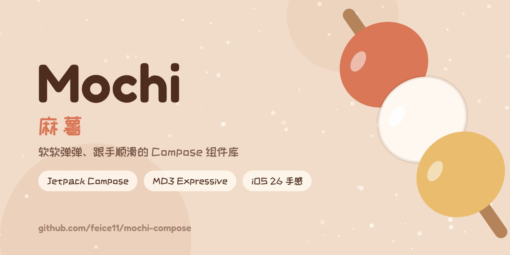
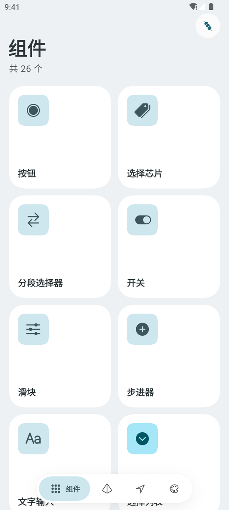
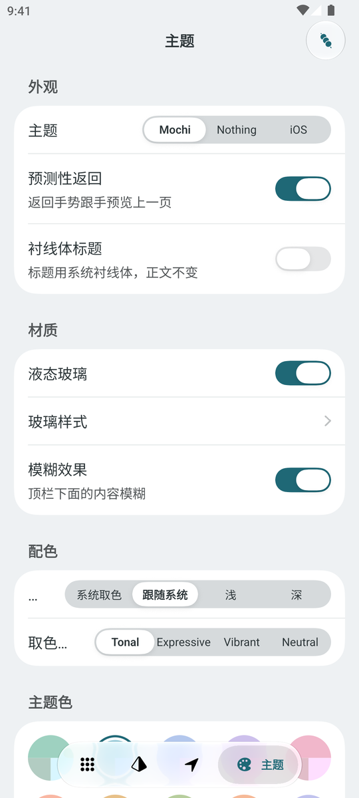
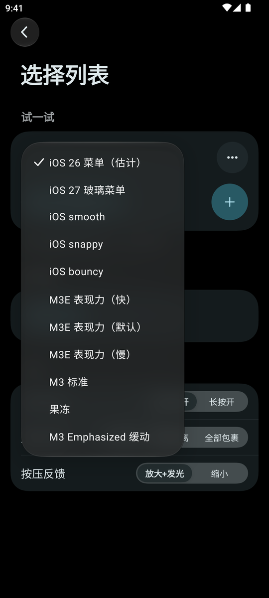
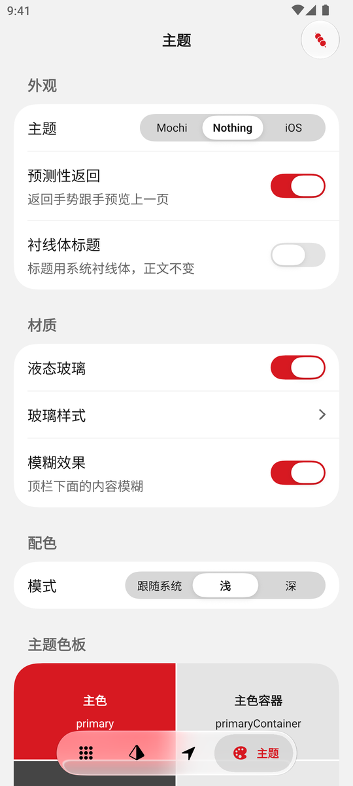

<p align="center">
  
</p>

<p align="center">Jetpack Compose 组件库：iOS 式的交互和动效、G2 连续圆角、AGSL 液态玻璃。</p>

<p align="center">
  <a href="https://central.sonatype.com/artifact/io.github.feice11/mochi-compose"></a>
  <a href="https://github.com/feice11/mochi-compose/actions/workflows/build.yml"></a>
  
  
  <a href="LICENSE"></a>
</p>

<p align="center">
  <a href="README.md">English</a> · 简体中文 · <a href="https://github.com/feice11/mochi-compose/releases/latest">示例 APK</a> · <a href="CHANGELOG.md">更新日志</a>
</p>

Mochi 是给 Jetpack Compose 应用用的界面库。配色和字阶照 Material 3 Expressive，交互和动效照 iOS 26：控件按住会跟着手指拉伸，菜单从打开它的按钮里长出来，页面侧推和返回都能中途打断。不依赖 `material3`。

<table>
  <tr>
    <td align="center" width="25%"><br><sub>组件目录</sub></td>
    <td align="center" width="25%"><br><sub>液态玻璃标签栏</sub></td>
    <td align="center" width="25%"><br><sub>深色模式的玻璃菜单</sub></td>
    <td align="center" width="25%"><br><sub>Nothing 外观</sub></td>
  </tr>
</table>

## 安装

```kotlin
dependencies {
    implementation("io.github.feice11:mochi-compose:0.3.0")

    // 按需添加
    implementation("io.github.feice11:mochi-icons:0.3.0")   // Ionicons 图标
    implementation("io.github.feice11:mochi-ios:0.3.0")     // iOS 外观
    implementation("io.github.feice11:mochi-nothing:0.3.0") // Nothing 外观
}
```

要求 compileSdk 36、Kotlin 2.3。发布在 Maven Central；0.1.x 的旧版本还在 JitPack（`com.github.feice11:mochi-compose`）。

## 用法

```kotlin
setContent {
    MochiTheme(controller = remember { ThemeController(ColorSchemeMode.MonetSystem) }) {
        var expanded by remember { mutableStateOf(false) }
        var selected by remember { mutableIntStateOf(0) }
        val items = remember { persistentListOf(MochiItem("最近"), MochiItem("名称"), MochiItem("大小")) }

        MochiDropdown(
            expanded = expanded,
            onExpandedChange = { expanded = it },
            items = items,
            onItemClick = { selected = it },
            selectedIndex = selected,
        ) {
            Text("排序：${items[selected].label}")
        }
    }
}
```

玻璃是主题里的一项设置，组件自己读，页面里不用写分支：

```kotlin
MochiTheme(colors = colors, materials = mochiGlassMaterials()) { /* … */ }
```

新项目可以直接复制 [MochiAppStarter.kt](example/src/main/java/ui/feice/mochi/starter/MochiAppStarter.kt)：一个能运行的三页骨架，主题、导航和共享顶栏都接好了。[接入指南](docs/zh_CN/guide/application-integration.md) 说明每部分需要怎么接；[llms.txt](llms.txt) 是给编程助手看的精简版。

## 组件

- 控件：[按钮与按钮组](docs/zh_CN/components/button.md)、[选择芯片](docs/zh_CN/components/chip.md)、[分段选择器](docs/zh_CN/components/segmented.md)、[开关](docs/zh_CN/components/switch.md)、[滑块](docs/zh_CN/components/slider.md)、[强度调整条](docs/zh_CN/components/intensity-slider.md)、[步进器](docs/zh_CN/components/stepper.md)、[文字输入](docs/zh_CN/components/textfield.md)
- 菜单与浮层：[下拉菜单](docs/zh_CN/components/dropdown.md)、[长按预览](docs/zh_CN/components/context-menu.md)、[弹出层](docs/zh_CN/components/popover.md)、[对话框](docs/zh_CN/components/dialog.md)、[提示](docs/zh_CN/components/toast.md)、[底部面板](docs/zh_CN/components/sheet.md)
- 列表：[分组列表、列表编辑、字母索引](docs/zh_CN/components/list.md)、[下拉刷新](docs/zh_CN/components/refresh.md)、[工具栏](docs/zh_CN/components/toolbar.md)
- 选择器：[滚筒与时间日期](docs/zh_CN/components/picker.md)、[日历](docs/zh_CN/components/calendar.md)、[颜色选择](docs/zh_CN/components/color-picker.md)、[选择卡片](docs/zh_CN/components/select-frame.md)
- 展示：[轮播](docs/zh_CN/components/pager.md)、[徽标、头像与仪表](docs/zh_CN/components/badge.md)、[图标](docs/zh_CN/components/icons.md)
- 导航：[大标题与搜索栏](docs/zh_CN/components/navbar.md)、[标签栏](docs/zh_CN/components/tabbar.md)、[侧边栏](docs/zh_CN/components/sidebar.md)、[页面转场与预测性返回](docs/zh_CN/guide/navigation.md)

指南：[主题与材质](docs/zh_CN/guide/theme.md)、[通用效果](docs/zh_CN/guide/effects.md)、[内容变换](docs/zh_CN/guide/content-transitions.md)、[越界回弹](docs/zh_CN/guide/overscroll.md)、[触感](docs/zh_CN/guide/haptics.md)、[iOS 外观](docs/zh_CN/guide/ios-theme.md)、[Nothing 外观](docs/zh_CN/guide/nothing-theme.md)、[HDR 高光](docs/zh_CN/guide/hdr.md)、[兼容性](docs/zh_CN/guide/compatibility.md)。

## 兼容性

只支持 Android，minSdk 23。低版本降级，不会坏：

| 功能 | 完整效果 | 降级 |
|---|---|---|
| 液态玻璃 | Android 13 | Android 12 用系统模糊加颜色矩阵，更低画纯色 |
| 融球、阴影、融色 | Android 13（`RuntimeShader`） | 两块纯色圆角形状 |
| 模糊、系统取色 | Android 12 | 淡入淡出和缩放；配色用种子色生成 |

开发者选项里关掉动画时，弹簧和拉伸效果也跟着关。应用也可以自己设 `LocalMochiReduceMotion`。

## 稳定性

还没到 1.0。小版本可能有不兼容的改动，每一处都写在 [更新日志](CHANGELOG.md) 的「不兼容」里，并附迁移方法。液态玻璃是 Beta，外观和 API 可能在小版本间调整。公开 API 记在 `<模块>/api/*.api`，CI 会检查。

## 构建

需要 JDK 17 和 Android SDK 36，截图测试要 JDK 21。

```bash
./gradlew :example:assembleRelease
./gradlew spotlessApply apiCheck :mochi-compose:verifyRoborazziDebug
```

提交改动前请看 [CONTRIBUTING.md](CONTRIBUTING.md)。

## Star 趋势

<a href="https://star-history.com/#feice11/mochi-compose&Date">
  <picture>
    <source media="(prefers-color-scheme: dark)" srcset="https://api.star-history.com/svg?repos=feice11/mochi-compose&type=Date&theme=dark">
    
  </picture>
</a>

## 赞助

Mochi 由我一个人业余维护。如果它帮你省了事，可以在 [爱发电](https://afdian.com/a/feice) 支持一下。赞助者名单每天自动更新。

<a href="https://afdian.com/a/feice"></a>

<!-- sponsors:start -->
<table>
  <tr>
    <td align="center"><br><sub>虚言_Xenith</sub></td>
    <td align="center"><br><sub>hrsthrt74</sub></td>
    <td align="center"><br><sub>Cremy_2449</sub></td>
    <td align="center"><br><sub>爱发电用户_19bf3</sub></td>
    <td align="center"><br><sub>蔡徐坤</sub></td>
    <td align="center"><br><sub>zitong</sub></td>
  </tr>
  <tr>
    <td align="center"><br><sub>小蜂-MCsmallbee</sub></td>
    <td align="center"><br><sub>洛茜不嘻嘻</sub></td>
    <td align="center"><br><sub>爱发电用户_wtBf</sub></td>
  </tr>
</table>
<!-- sponsors:end -->

## 致谢

- [Kyant0/Capsule](https://github.com/Kyant0/Capsule)：连续圆角形状
- [liquid.refract.im](https://liquid.refract.im/launch/)：液态玻璃渲染移植自这个 WebGL 版本（已获许可）
- [Bear](https://github.com/mif9499)：计数器的滚动数字
- [miuix](https://github.com/compose-miuix-ui/miuix)：工程规范参考
- [Ionicons](https://ionic.io/ionicons)（MIT）：`mochi-icons` 的图标

## 许可

[Apache License 2.0](LICENSE)。第三方声明见 [THIRD_PARTY_NOTICES.md](THIRD_PARTY_NOTICES.md)。
